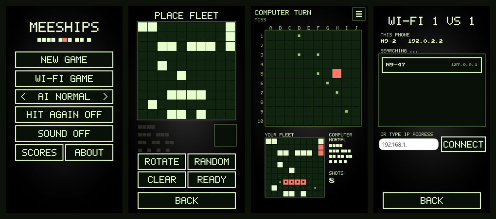

# MeeShips

Battleships for the **Nokia N9** (MeeGo Harmattan) in raw 8-bit style: flat square blocks, a black sea and a chunky pixel font.



## Features
- Classic fleet on a 10×10 sea: one ship of four squares, two of three, three of two and four of one. Ships never touch, not even at the corners.
- Place your fleet by tapping squares (ROTATE, RANDOM, CLEAR), or let the game place it at random.
- Play against the computer: **EASY**, **NORMAL** or **HARD**. HARD counts every possible position of the remaining ships and fires at the most likely square.
- **Wi-Fi 1 vs 1** between two N9 phones: phones running MeeShips in the same network find each other automatically (UDP broadcast). Tap a phone to invite it. You can also type its IP address.
- Optional rule **HIT AGAIN** (off by default): after a hit you shoot again.
- Water around a sunk ship is marked automatically.
- Wins, losses and the fewest shots needed to win, per level and for Wi-Fi games.
- Simple 8-bit sound effects (can be switched off). English and Polish.

## Install
Copy `dist/meeships-n9_0.1.2_armel.deb` to the phone and install it as root:

```
dpkg -i meeships-n9_0.1.2_armel.deb
```

## Wi-Fi game protocol
The network part (`src/gamenet.h`, `src/gamenet.cpp`) is a small reusable 1 vs 1 layer, exposed to QML as `GameNet` (`import MeeGames 1.0`):
- discovery: UDP broadcast on port 45454 every 1.5 s: `MEEGAMES 1 <game> <tcpPort> <busy> <token> <name>`
- game link: TCP port 45455 (next free up to 45460), UTF-8 text lines `HELLO`, `ACCEPT`, `DECLINE`, `MSG <text>`, `PING`, `PONG`, `BYE`; the connection is considered lost after 8 s of silence
- MeeShips messages inside `MSG` are JSON: `ready`, `start`, `shot`, `res`, `reveal`, `again`

## Build
Native Qt 4.7 / QML launcher (no Python), cross-built with clang for ARMv7 hard-float against the Harmattan libraries: see `build.sh` and `packaging/make-deb.sh`. Sounds: `tools/make-ship-sounds.py`; icon: `tools/meeships-icon.py`.

The arcade digits use the Press Start 2P font (© The Press Start 2P Project Authors, SIL Open Font License 1.1, `qml/fonts/`).

## Credits
Designed and written by Claude (Anthropic) together with [smyhu](https://github.com/smyhu) for the Nokia N9.

## License
MIT, see [LICENSE](LICENSE).
